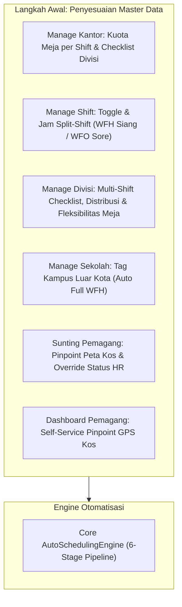
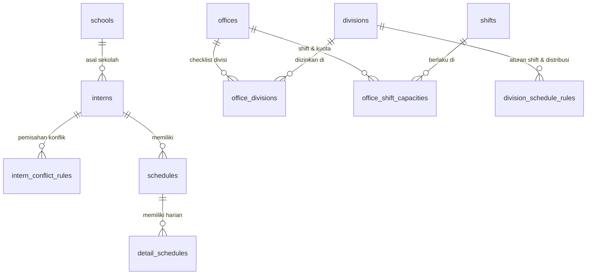
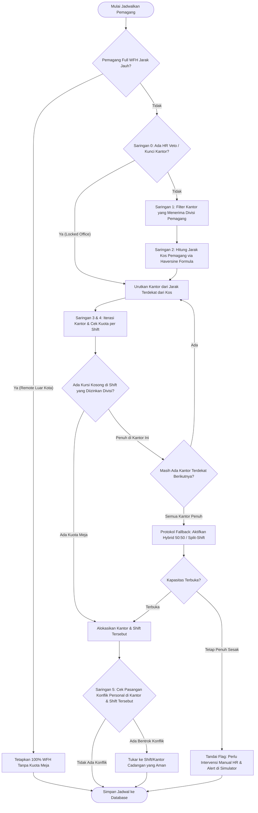
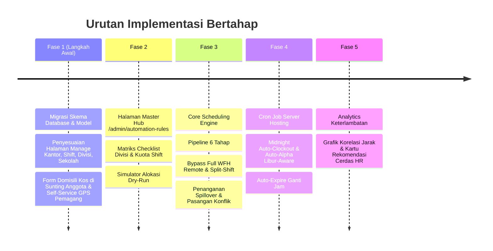

# 🧠 BLUEPRINT ARSITEKTUR & RENCANA IMPLEMENTASI SISTEM PENJADWALAN OTOMATIS CERDAS (SMART AUTO-SCHEDULING & EFFECTIVENESS ENGINE)
### Aplikasi Absensi & Manajemen Magang — Absen-Djuragan

> **Dokumen Spesifikasi Desain Sistem & Panduan Implementasi Lengkap**  
> Dibuat: 2026-10-03 | Terakhir Diperbarui: 2026-10-03 | Status: **Draft Disempurnakan — Siap Diimplementasikan**  
> Target File: `docs/AUTOMATISASI_PLANS.md`

---

## 📑 DAFTAR ISI

1. [Ringkasan Eksekutif & Latar Belakang Masalah](#1-ringkasan-eksekutif--latar-belakang-masalah)
2. [Stack Teknologi & Tools yang Digunakan (100% Open-Source & Zero-Cost)](#2-stack-teknologi--tools-yang-digunakan-100-open-source--zero-cost)
3. [Langkah Awal: Penyesuaian pada Halaman Manajemen yang Sudah Ada](#3-langkah-awal-penyesuaian-pada-halaman-manajemen-yang-sudah-ada)
4. [Desain Skema Database Baru & Modifikasi Relasi](#4-desain-skema-database-baru--modifikasi-relasi)
5. [Antarmuka Admin Terpadu (Unified Admin Automation Hub UI/UX)](#5-antarmuka-admin-terpadu-unified-admin-automation-hub-uiux)
6. [Algoritma Core Scheduling Engine (Pipeline Filter 6 Tahap)](#6-algoritma-core-scheduling-engine-pipeline-filter-6-tahap)
7. [Otomatisasi Server & Cron Job Hosting (cPanel / VPS)](#7-otomatisasi-server--cron-job-hosting-cpanel--vps)
8. [Engine Evaluasi Efektivitas Berbasis Keterlambatan (Punctuality Analytics)](#8-engine-evaluasi-efektivitas-berbasis-keterlambatan-punctuality-analytics)
9. [Sistem Rekomendasi Cerdas untuk HR & Owner (Decision Support System)](#9-sistem-rekomendasi-cerdas-untuk-hr--owner-decision-support-system)
10. [Roadmap Implementasi Bertahap & Validasi Edge Cases](#10-roadmap-implementasi-bertahap--validasi-edge-cases)

---

## 1. RINGKASAN EKSEKUTIF & LATAR BELAKANG MASALAH

### 1.1. Konteks Permasalahan Nyata di Lapangan
Seiring berkembangnya Absen-Djuragan, penempatan pemagang tidak lagi sesederhana membagi rata secara manual:
1. **Keterbatasan Kapasitas Kantor (Desk Overcrowding):** Kantor fisik memiliki batas jumlah kursi/meja. Jika suatu divisi memiliki banyak anggota, kantor fisik tidak mampu menampung semuanya sekaligus.
2. **Tabrakan Antar-Shift (Shift Overlap):** Shift Pagi (08:00–16:00) dan Shift Siang (13:00–21:00) mengalami bentrok jam kerja selama 3 jam (13:00–16:00). Pada rentang waktu ini, meja kantor terbebani dua kali lipat jika kedua shift hadir fisik di kantor.
3. **Efisiensi Jarak & Geografis (Commute Fatigue):** Pemagang yang tinggal jauh dari kantor penempatan mengalami kelelahan di jalan, berisiko tinggi terlambat, dan performa menurun. Sebaliknya, kantor cabang lain yang lebih dekat mungkin memiliki meja kosong.
4. **Spesialisasi Kantor per Divisi:** Tidak semua kantor bisa diisi oleh sembarang divisi. Misal Kantor A khusus IT & Multimedia (butuh PC spesifikasi tinggi/studio), sedangkan Kantor B khusus Marketing & Admin.
5. **Kasus Khusus Pemagang Luar Kota / Jauh (Full WFH Remote):** Terdapat pemagang dari kampus/sekolahan tertentu yang berdomisili di luar kota/pulau yang sejak awal disepakati **100% Full WFH dari rumah asal**. Mereka tidak boleh dihitung dalam kuota meja kantor manapun dan tidak perlu diukur jarak fisiknya ke kantor.
6. **Dinamika Sosial & Disiplin HR (HR Veto):** Terdapat pemagang yang bermasalah secara interpersonal (toxic, konflik personal, atau request pengawasan khusus dari HR/Owner) yang tidak boleh disatukan dalam satu ruangan/kantor dengan pihak tertentu.
7. **Ketiadaan Evaluasi Data-Driven:** HR dan Owner belum memiliki instrumen analisis otomatis untuk mengetahui apakah penjadwalan yang berjalan sudah efektif, khususnya **apakah ada shift atau kantor tertentu yang memicu tingginya angka keterlambatan**.

### 1.2. Visi Sistem Otomatisasi Cerdas
Sistem ini dirancang untuk mengubah proses penjadwalan dari pekerjaan manual yang memakan waktu berjam-jam menjadi **sistem cerdas otomatis berbasis aturan multi-variabel (Rule-based Constraint Solver)** yang adil, efisien, terukur, dan bebas konflik meja.

---

## 2. STACK TEKNOLOGI & TOOLS YANG DIGUNAKAN (100% REUSABLE DARI PROJECT INI & ZERO-COST)

Sistem ini dirancang dengan prinsip **memaksimalkan teknologi yang SUDAH ADA dan SEDANG BERJALAN di dalam project Absen-Djuragan saat ini**, sehingga dijamin **100% kompatibel dan tidak akan menyebabkan konflik/error pustaka**:

### 2.1. Penjelasan Sinergi Modul Peta (Bukan Pustaka Terpisah yang Bersaing, Melainkan 1 Paket Kesatuan)
> [!NOTE]
> **Apakah Fitur Peta Memakai Banyak Tool Berbeda?**  
> **Jawabannya: TIDAK.** Fitur peta ini sebenarnya adalah **1 kesatuan fitur tunggal** yang cara kerjanya saling melengkapi seperti halnya sebuah pemutar video:
> - **Leaflet.js (Pemutar / Mesin Layar Peta):** Library JavaScript yang membuat peta di layar bisa digeser, di-*zoom*, dan diletakkan pin marker. Leaflet **tidak punya gambar peta sendiri**.
> - **OpenStreetMap / OSM (Kertas Gambar Petanya):** Tile gambar jalan dan wilayah bumi yang dimasukkan ke dalam Leaflet agar layarnya tidak kosong abu-abu.
> - **Nominatim (Buku Alamat / Mesin Pencarian):** Fitur bawaan OpenStreetMap untuk mencari nama jalan/kos (*"Jalan Kaliurang"*) menjadi angka Latitude & Longitude.
> - **Haversine Formula (Bukan Tool/Library):** Ini hanyalah **rumus matematika trigonometri murni** sepanjang 5 baris kode PHP di server untuk mengukur jarak kilometer dari kos pemagang ke kantor.
>
> ⭐️ **Fakta Penting di Codebase Saat Ini:**  
> Paket kesatuan ini **SUDAH TERPASANG DAN SUDAH AKTIF BERJALAN** di codebase kita:
> 1. Pustaka Leaflet sudah dimuat secara global di layout admin: [`resources/views/layouts/main.blade.php`](file:///d:/laragon/www/absen-djuragan/resources/views/layouts/main.blade.php#L22-L25).
> 2. Implementasi lengkap Leaflet + OSM + Nominatim sudah terbukti berjalan sangat stabil di modul lokasi kantor: [`resources/views/admin/edit-maps-location.blade.php`](file:///d:/laragon/www/absen-djuragan/resources/views/admin/edit-maps-location.blade.php#L11-L13).  
> **Artinya, untuk peta kos pemagang, kita hanya MENG-COPY & MEMAKAI ULANG kode yang sudah ada, tanpa perlu instalasi atau coba-coba library baru!**

---

### 2.2. Matriks Stack Teknologi & Kesesuaian dengan Project Existing

| Kategori | Tool / Library yang Dipilih | Status di Project Saat Ini | Peran & Jaminan Keandalan |
|---|---|---|---|
| **Peta Interaktif** | **Leaflet.js (v1.9.4) + OpenStreetMap** | ✅ **Sudah Ada** di `layouts/main.blade.php` & `edit-maps-location.blade.php` | Menampilkan peta interaktif modal popup untuk memilih titik kos pemagang. Tidak ada instalasi baru. |
| **Pencarian Alamat** | **Nominatim Search API** | ✅ **Sudah Ada** di `edit-maps-location.blade.php` (baris 472) | Autocomplete pencarian teks nama alamat/kos menjadi koordinat Lat/Lng gratis tanpa API Key. |
| **Kalkulator Jarak** | **PHP Native Trigonometry (Haversine Formula)** | ✅ **Native PHP** bawaan server | Rumus matematika murni di backend (`sin`, `cos`, `asin`). 0 dependency, kalkulasi secepat kilat (mikrodetik). |
| **Backend & Engine** | **PHP 8.2+ & Laravel 10** | ✅ **Pondasi Utama** project | Service class khusus `App\Services\AutoSchedulingEngine.php` dengan transaksi database aman (`DB::beginTransaction`). |
| **Database** | **MySQL 8.0+ / MariaDB** | ✅ **Database Utama** project | Penjadwalan disimpan di tabel `schedules` & `detail_schedules` dengan indexing komposit yang efisien. |
| **Komponen UI & Modal** | **Blade, Tailwind CSS 3.4 & SweetAlert2** | ✅ **Sudah Ada** di `layouts/main.blade.php` (baris 28) | Styling form dan dialog konfirmasi/alert intervensi HR menggunakan SweetAlert2 yang sudah terpasang global. |
| **Reaktivitas UI** | **Livewire 3.5 & Alpine.js** | ✅ **Sudah Ada** via `@livewireStyles` di project | Mengatur tab pusat kendali dan checklist divisi secara reaktif tanpa me-refresh halaman. |
| **Ikon Antarmuka** | **FontAwesome 6** | ✅ **Sudah Ada** di `layouts/main.blade.php` (baris 21) | Ikon visual status WFO 🏢, WFH 🏠, GPS 📍, dan Split-Shift ⏱️. |
| **Visualisasi Grafik** | **Tailwind Native Bar / Chart.js via CDN** | ✅ **Ringan & Aman** | Menampilkan diagram persentase keterlambatan per shift dan grafik evaluasi efektivitas di dashboard HR. |
| **Server Cron Task** | **Laravel Console Scheduler** | ✅ **Bawaan Laravel** | Menjalankan auto-clockout, auto-alpha hari libur, dan jadwal mingguan cukup dengan 1 baris cron di cPanel hosting. |

> [!TIP]
> **Kesimpulan Kompatibilitas:**  
> Karena hampir **100% komponen di atas sudah terpasang dan bekerja di project ini**, risiko terjadinya konflik dependensi (*dependency collision*) atau error library pada tahap implementasi adalah **NOL (0%)**.

---

## 3. LANGKAH AWAL: PENYESUAIAN PADA HALAMAN MANAJEMEN YANG SUDAH ADA

Sebelum "Engine Otomatisasi Penjadwalan" dijalankan, **seluruh master data pendukung harus siap terlebih dahulu**. Penyesuaian ini dilakukan pada halaman-halaman yang sudah ada di sistem saat ini:



### 2.1. Penyesuaian di Halaman Manage Kantor (`SettingOfficeController` / Edit Kantor)
- **Kapasitas Meja per Shift:** Input kuota maksimal kursi/meja yang tersedia untuk masing-masing shift yang aktif di kantor tersebut (misal: Shift Pagi 20 meja, Shift Siang 20 meja).
- **Checklist Divisi:** Checkbox divisi mana saja yang diizinkan/memiliki fasilitas di kantor tersebut. Kantor tanpa checklist divisi terkait tidak akan dipilih oleh engine untuk divisi tersebut.

### 2.2. Penyesuaian di Halaman Manage Shift (`SettingShiftController` / Edit Shift)
- **Toggle Split-Shift Intra-Day:** Pilihan apakah shift ini bertipe split-shift.
- **Konfigurasi Jam Sesi:**
  - Jam Mulai & Selesai WFH (Contoh: `13:00 - 16:00`).
  - Jam Mulai & Selesai WFO (Contoh: `16:00 - 21:00`).
- Memungkinkan pemagang shift siang mulai bekerja dari kos terlebih dahulu agar tidak menabrak shift pagi yang baru pulang jam 16:00.

### 2.3. Penyesuaian di Halaman Manage Divisi (`SettingDivisionController` / Edit Divisi)
> [!IMPORTANT]
> **Koreksi Penting Logika Lapangan:** Di dunia nyata, anggota dalam satu divisi **TIDAK BISA** disamaratakan satu shift atau satu kantor yang sama! Satu divisi dapat disebar ke beberapa kantor yang berbeda (mengikuti kedekatan kos masing-masing anak), dan di dalam satu kantor pun anggotanya memakai berbagai shift yang berbeda (ada yang Pagi, Siang, Middle) agar kapasitas meja bergantian.
> 
> Oleh karena itu, di Manage Divisi **BUKAN** mengunci 1 status mati ("Full WFO"), melainkan mengatur **Strategi Distribusi Multi-Shift & Fleksibilitas Divisi**:

- **Checklist Shift yang Diizinkan untuk Divisi Ini (Allowed Shifts):**
  - Menentukan shift apa saja yang relevan dan boleh dipakai oleh divisi ini (misal Divisi IT mencentang: `[x] Shift Pagi`, `[x] Shift Siang`, `[x] Shift Middle`). Shift yang tidak dicentang tidak akan diberikan ke divisi ini.
- **Strategi Distribusi Shift Antar-Anggota Divisi:**
  - `Proporsional / Bagi Rata Kuota (Quota Balancing - Default)`: Membagi anggota divisi secara merata ke shift-shift yang tersedia (misal 50% masuk Shift Pagi, 50% masuk Shift Siang) agar kapasitas kantor tidak meledak di pagi hari.
  - `Rotasi Mingguan (Weekly Rolling)`: Anggota bergantian shift setiap minggu (Minggu ini Pagi, Minggu depan Siang).
  - `Prioritas Jarak Kos`: Anggota dengan jarak kos jauh (>7 km) otomatis diprioritaskan mendapat Shift Middle/Siang agar tidak terjebak macet jam 07:30 pagi.
- **Penyebaran Multi-Kantor per Divisi (Multi-Office Splitting):**
  - Anggota divisi yang sama **disebar ke kantor berbeda** secara otomatis berdasarkan **jarak kos terdekat masing-masing anak** ke kantor yang mencentang divisi tersebut (misal: 6 anak IT yang kos di Sleman ke Kantor Pusat, 4 anak IT yang kos di Bantul ke Kantor Timur).
- **Aturan Fleksibilitas Meja (Work Mode Adaptation):**
  - `[x] Izinkan Mode Hybrid Seimbang (Hybrid 1 & 2)`: Jika kuota meja di kantor tujuan sudah menipis, sistem otomatis membagi anggota 50% ganjil (Senin/Rabu/Jumat WFH) dan 50% genap (Selasa/Kamis/Sabtu WFH).
  - `[x] Terapkan Split-Shift pada Shift Siang`: Anggota yang dialokasikan ke shift siang otomatis menjalankan sesi 13:00–16:00 WFH di kos, lalu 16:00–21:00 WFO ke kantor setelah shift pagi pulang.

### 2.4. Penyesuaian di Halaman Manage Sekolah/Kampus (`SettingSchoolController` / Edit Sekolah)
- **Checkbox "Kampus / Sekolah Luar Kota (Full WFH Otomatis)":**
  - Jika dicentang, seluruh pemagang baru yang terdaftar dari kampus/sekolah tersebut **secara otomatis mendapatkan status Full WFH Jarak Jauh (Remote)**.
  - Sangat menghemat waktu jika ada 1 batch (misal 10–20 mahasiswa) dari universitas luar kota/pulau.

### 2.5. Penyesuaian di Halaman Sunting Pemagang (`sunting-anggota.blade.php`)
- **Card Domisili & Titik Kos:**
  - Input teks alamat/catatan kos.
  - Kolom koordinat `home_latitude` dan `home_longitude`.
  - Tombol **"🗺️ Buka Peta Pinpoint (Modal Leaflet)"** dengan pencarian alamat Nominatim otomatis dan pin marker yang bisa digeser (*draggable*).
  - Tampilan estimasi jarak *real-time* ke semua kantor cabang.
- **Card Penempatan Khusus & Disiplin HR (HR Veto):**
  - **Pilihan Status Penempatan:**
    - `(o) Otomatis Berdasarkan Jarak & Kuota Meja (Default)`
    - `( ) Full WFH Jarak Jauh (Magang dari Rumah Asal / Luar Kota)` — *Melewati perhitungan jarak & tidak memakan kuota meja kantor.*
    - `( ) Kunci Penempatan (Wajib di Kantor Tertentu)` — *Hak Veto HR.*
  - **Blacklist Kantor:** Melarang pemagang ditempatkan di kantor tertentu.
  - **Pasangan Konflik (Conflict Pair):** Mencegah ditempatkan satu kantor dengan individu tertentu.
  - **Catatan Rahasia HR:** Catatan internal HR yang tidak dapat dilihat oleh pemagang.

### 2.6. Penyesuaian di Sisi Pemagang (Dashboard `users/index.blade.php`)
- **Self-Service Pinpoint Titik Kos (GPS Otomatis):**
  - Modal/Banner kecil bagi pemagang: *"📍 Tentukan Titik Kos / Rumah Anda"*.
  - Pemagang cukup membuka dashboard dari HP/laptop di kos mereka dan menekan tombol **"Gunakan Lokasi GPS Saya Saat Ini"**. Koordinat langsung tersimpan ke profil tanpa merepotkan admin.
- **Tampilan Jadwal Minggu Ini Tetap Simpel (Hanya WFO atau WFH):**
  - Di mata pemagang, tabel jadwal mingguan **TIDAK PERNAH menampilkan istilah teknis rumit** seperti *"Hybrid 1"*, *"Hybrid 2"*, atau istilah algoritma lainnya.
  - Setiap baris hari kerja hanya menampilkan badge tegas dan jelas:
    - **`WFO` (Hijau 🏢):** Pemagang wajib mandi, rapi, dan berangkat ke kantor fisik (termasuk untuk jadwal normal maupun split-shift).
    - **`WFH` (Biru 🏠):** Pemagang belajar/bekerja dari rumah/kos.
  - Untuk hari **Split-Shift**:
    - Status utama tetap **`WFO`** (karena pemagang wajib hadir fisik di kantor dari sore hingga malam).
    - Terdapat sub-keterangan kecil pada jam shift: *"13:00–16:00 Mulai di Kos, 16:00–21:00 Lanjut di Kantor"*.

---

## 4. DESAIN SKEMA DATABASE BARU & MODIFIKASI RELASI



### 4.1. Penambahan Kolom pada Tabel `interns`
```php
// Migration: add_automation_and_remote_fields_to_interns_table.php
Schema::table('interns', function (Blueprint $table) {
    // Koordinat Kos / Domisili Pemagang
    $table->decimal('home_latitude', 10, 8)->nullable()->after('end_date');
    $table->decimal('home_longitude', 11, 8)->nullable()->after('home_latitude');
    $table->string('home_address_notes')->nullable()->after('home_longitude');

    // Tipe Penempatan: 'auto_office' (Default), 'full_wfh_remote' (Luar Kota/Rumah Asal), 'locked_office'
    $table->string('work_placement_type', 30)->default('auto_office')->after('home_address_notes');

    // HR Disciplinary Veto & Penempatan Khusus
    $table->foreignId('locked_office_id')->nullable()->constrained('offices')->nullOnDelete()->after('work_placement_type');
    $table->foreignId('blacklisted_office_id')->nullable()->constrained('offices')->nullOnDelete()->after('locked_office_id');
    $table->text('hr_placement_notes')->nullable()->after('blacklisted_office_id');
});
```

### 4.2. Penambahan Kolom pada Tabel `schools`
```php
// Migration: add_is_remote_to_schools_table.php
Schema::table('schools', function (Blueprint $table) {
    // Jika true, seluruh pemagang dari sekolah ini otomatis berstatus 'full_wfh_remote'
    $table->boolean('is_remote_school')->default(false)->after('name');
});
```

### 4.3. Pivot Table Checklist Divisi per Kantor (`office_divisions`)
```php
// Migration: create_office_divisions_table.php
Schema::create('office_divisions', function (Blueprint $table) {
    $table->id();
    $table->foreignId('office_id')->constrained('offices')->cascadeOnDelete();
    $table->foreignId('division_id')->constrained('divisions')->cascadeOnDelete();
    $table->boolean('is_active')->default(true);
    $table->timestamps();

    $table->unique(['office_id', 'division_id']);
});
```

### 4.4. Matriks Shift Aktif & Kapasitas Meja Kantor (`office_shift_capacities`)
```php
// Migration: create_office_shift_capacities_table.php
Schema::create('office_shift_capacities', function (Blueprint $table) {
    $table->id();
    $table->foreignId('office_id')->constrained('offices')->cascadeOnDelete();
    $table->foreignId('shift_id')->constrained('shifts')->cascadeOnDelete();
    $table->unsignedInteger('max_capacity')->default(15); // Kuota meja shift ini di kantor ini
    $table->boolean('is_enabled')->default(true);
    $table->timestamps();

    $table->unique(['office_id', 'shift_id']);
});
```

### 4.5. Penambahan Kolom Split-Shift pada Tabel `shifts`
```php
// Migration: add_split_shift_settings_to_shifts_table.php
Schema::table('shifts', function (Blueprint $table) {
    $table->boolean('is_split_shift')->default(false)->after('is_friday_break_active');
    $table->time('split_wfh_start')->nullable()->after('is_split_shift'); // Contoh: 13:00
    $table->time('split_wfh_end')->nullable()->after('split_wfh_start');   // Contoh: 16:00
    $table->time('split_wfo_start')->nullable()->after('split_wfh_end');   // Contoh: 16:00
    $table->time('split_wfo_end')->nullable()->after('split_wfo_start');   // Contoh: 21:00
});
```

### 4.6. Aturan Distribusi Shift & Fleksibilitas Divisi (`division_schedule_rules`)
```php
// Migration: create_division_schedule_rules_table.php
Schema::create('division_schedule_rules', function (Blueprint $table) {
    $table->id();
    $table->foreignId('division_id')->unique()->constrained('divisions')->cascadeOnDelete();
    
    // Shift yang diizinkan untuk divisi ini (array ID shift, misal [2, 3, 4])
    $table->json('allowed_shift_ids')->nullable();
    
    // Metode distribusi shift: 'balanced_quota' (Bagi rata), 'weekly_rotation' (Gantian per minggu), 'distance_optimized' (Prioritas jarak kos)
    $table->string('shift_distribution_mode', 50)->default('balanced_quota');
    
    // Aturan fleksibilitas meja kantor
    $table->boolean('allow_hybrid_balancing')->default(true); // Izinkan pecah Hybrid 1 & 2 jika meja penuh
    $table->boolean('allow_split_shift')->default(true);       // Izinkan Split-Shift pada shift siang
    
    $table->timestamps();
});
```

### 4.7. Tabel Pasangan Konflik Personal (`intern_conflict_rules`)
```php
// Migration: create_intern_conflict_rules_table.php
Schema::create('intern_conflict_rules', function (Blueprint $table) {
    $table->id();
    $table->foreignId('intern_id_1')->constrained('interns')->cascadeOnDelete();
    $table->foreignId('intern_id_2')->constrained('interns')->cascadeOnDelete();
    $table->string('reason')->nullable();
    $table->boolean('is_active')->default(true);
    $table->timestamps();

    $table->unique(['intern_id_1', 'intern_id_2']);
});
```

### 4.8. Modifikasi Kolom pada Tabel `detail_schedules` (Work Type, Hybrid Pattern, Spillover)
> [!NOTE]
> **Hakikat Status Split-Shift adalah WFO:**  
> Secara operasional dan rekapitulasi HR, pemagang pada Split-Shift **status dasarnya tetap WFO (Kerja di Kantor)** karena setiap hari mereka wajib hadir fisik di kantor, mengisi meja kantor dari sore hingga malam (16:00–21:00), dan menggunakan fasilitas kantor. Sesi 13:00–16:00 di kos hanyalah *taktik rotasi meja* agar tidak menabrak Shift Pagi yang baru pulang jam 16:00.
> 
> Di sisi pemagang (dashboard `users/index.blade.php`), badge jadwal harian mereka **tetap tampil sebagai WFO (Hijau)** dengan jam kerja 13:00–21:00.

```php
// Migration: modify_work_type_and_add_hybrid_fields_to_detail_schedules_table.php
Schema::table('detail_schedules', function (Blueprint $table) {
    // Ubah work_type menjadi string/varchar agar fleksibel menampung 'wfo', 'wfh', 'split_shift'
    $table->string('work_type', 20)->default('wfo')->change();

    // Penanda pola hybrid: 'none', 'hybrid_1' (ganjil WFH), 'hybrid_2' (genap WFH)
    $table->string('hybrid_pattern', 20)->default('none')->after('work_type');

    // Penanda apakah alokasi ini hasil pengalihan (overflow) karena kantor utama penuh
    $table->boolean('is_spillover')->default(false)->after('hybrid_pattern');
});
```

### 4.9. Penanganan Kompatibilitas pada 10 File Presensi Existing
Di dalam codebase Absen-Djuragan, terdapat **10 file PHP** yang saat ini mengecek `detailSchedule->work_type` untuk menentukan apakah GPS wajib aktif atau tidak:
1. `app/Livewire/AttdStatusButton.php`
2. `app/Services/Attendance/State/AttendanceInState.php`
3. `app/Services/Attendance/State/AttendanceOutState.php`
4. `app/Services/Attendance/State/AdjustableInState.php`
5. `app/Services/Attendance/State/AdjustableOutState.php`
6. `app/Services/AttendanceService.php`
7. `app/Services/ScheduleService.php`
8. `app/Http/Controllers/ScheduleController.php`
9. `app/Http/Controllers/OfflineAttendanceController.php`
10. `app/Models/DetailSchedule.php`

**Strategi Kompatibilitas Aman (Zero-Breakage):**
1. **Untuk Hari Kerja Hybrid 1 & 2:**  
   Engine otomatis menetapkan nilai harian `work_type` langsung sebagai `'wfh'` (pada hari ganjil) atau `'wfo'` (pada hari genap), sementara label `'hybrid_1'` / `'hybrid_2'` disimpan di kolom `hybrid_pattern`. Dengan cara ini, **seluruh 10 file presensi existing tetap bekerja 100% normal tanpa risiko bug**, dan pemagang melihat badge jelas (WFO/WFH).
2. **Untuk Mode Split-Shift (Tetap WFO):**  
   Di laporan dan dashboard pemagang, status terhitung sebagai **WFO**. Pada `AttdStatusButton.php` dan `AttendanceInState.php`, ditambahkan pengecekan transisi waktu:
   - Jika `work_type === 'split_shift'` (atau shift memiliki flag `is_split_shift = true`) dan jam saat ini belum mencapai `split_wfo_start` (misal sebelum 16:00): Presensi sesi 1 diizinkan tap-in dari kos (GPS radius kantor tidak diwajibkan).
   - Begitu jam melewati `split_wfo_start` (misal pukul 16:00 ke atas hingga jam pulang 21:00): Presensi beralih penuh menjadi **WFO** (wajib berada di radius GPS kantor).

---

## 5. ANTARMUKA ADMIN TERPADU (UNIFIED ADMIN AUTOMATION HUB UI/UX)

Untuk kemudahan operasional sehari-hari, admin disediakan **Satu Halaman Pusat Kendali** (`/admin/automation-rules`):

```
┌──────────────────────────────────────────────────────────────────────────────────────────────────┐
│ ⚙️ PUSAT ATURAN & OTOMATISASI JADWAL MAGANG                                     [ Simpan Aturan ] │
├──────────────────────────────────────────────────────────────────────────────────────────────────┤
│ [ Tab 1: Checklist Divisi ] [ Tab 2: Shift & Kuota Meja ] [ Tab 3: Pola Kerja ] [ Tab 4: Generator]│
├──────────────────────────────────────────────────────────────────────────────────────────────────┤
│                                                                                                  │
│ MATRIKS CHECKLIST DIVISI PER KANTOR                                                              │
│ Centang kantor mana saja yang menerima masing-masing divisi:                                     │
│                                                                                                  │
│ ┌──────────────────────┬────────────────┬────────────────┬────────────────┬────────────────────┐ │
│ │ Divisi               │ Kantor Pusat   │ Kantor Studio  │ Kantor Timur   │ Kantor Barat       │ │
│ ├──────────────────────┼────────────────┼────────────────┼────────────────┼────────────────────┤ │
│ │ IT & Programmer      │  [x] Aktif     │  [ ] Nonaktif  │  [x] Aktif     │  [ ] Nonaktif      │ │
│ │ Multimedia & Video   │  [ ] Nonaktif  │  [x] Aktif     │  [ ] Nonaktif  │  [ ] Nonaktif      │ │
│ │ Marketing & Sales    │  [x] Aktif     │  [ ] Nonaktif  │  [x] Aktif     │  [x] Aktif         │ │
│ └──────────────────────┴────────────────┴────────────────┴────────────────┴────────────────────┘ │
│                                                                                                  │
└──────────────────────────────────────────────────────────────────────────────────────────────────┘
```

### Tab-Tab di Halaman Pusat Aturan:
1. **Tab 1: Matriks Checklist Divisi per Kantor:** Tabel silang (*Cross-Matrix Grid*) dengan centang checkbox yang menentukan kantor mana saja yang menerima divisi tertentu.
2. **Tab 2: Shift Aktif & Kuota Meja Kantor:** Input kuota kursi maksimal per shift per kantor, mendukung lebih dari 3 shift.
3. **Tab 3: Distribusi Shift & Fleksibilitas Divisi:** Menentukan shift yang diizinkan (`allowed_shift_ids`), strategi pembagian shift antar-anggota (Proporsional Kuota, Rotasi Mingguan, Prioritas Jarak Kos), serta izin penerapan Hybrid Seimbang dan Split-Shift.
4. **Tab 4: Simulator & Generator Jadwal (Preview & Deploy):**
   - Opsi pilih periode (Mingguan / Bulanan).
   - Tombol **"Jalankan Simulasi (Dry Run Preview)"**: Menampilkan simulasi penempatan meja kantor tanpa mengubah database (melihat sebaran anak per kantor dan per shift).
   - Tombol **"Terapkan & Buat Jadwal Final"**: Menyimpan hasil alokasi ke `schedules` dan `detail_schedules`.

---

## 6. ALGORITMA CORE SCHEDULING ENGINE (PIPELINE FILTER 6 TAHAP)

Engine bekerja menggunakan mekanisme saringan bertingkat (*Multi-Stage Constraint Resolution*) yang memperlakukan setiap individu pemagang secara cerdas dan bebas deadlock:



### 6.1. Logika Saringan Engine

#### Tahap 0-A: Deteksi Pemagang Full WFH Jarak Jauh (Remote)
- Cek apakah `intern.work_placement_type === 'full_wfh_remote'` ATAU `intern.school.is_remote_school === true`.
- **Jika Ya:**
  - Pemagang langsung ditetapkan **Full WFH (100%)**.
  - **Beban kuota meja kantor = 0** (tidak memakan kursi fisik manapun).
  - Melewati kalkulasi jarak kos dan **melewati pengecekan konflik kantor** (karena tidak pernah hadir fisik).
  - Seluruh `detail_schedules.work_type` diset `'wfh'`. Langsung disimpan ke database.

#### Tahap 0-B: Saringan Veto HR & Disiplin
- Jika pemagang memiliki `locked_office_id`: Kantor kandidat langsung dikunci ke kantor tersebut (mengabaikan jarak kos).
- Jika pemagang memiliki `blacklisted_office_id`: Kantor tersebut langsung dihapus dari daftar kantor kandidat.

#### Tahap 1: Saringan Checklist Divisi per Kantor
- Mengambil kantor-kantor yang memiliki checklist aktif untuk `intern.division_id` di tabel pivot `office_divisions`.

#### Tahap 2: Saringan Jarak Terdekat (Penyebaran Multi-Kantor per Anak)
- Untuk anak-anak dalam divisi yang sama, sistem **TIDAK menumpuk mereka di satu kantor**.
- Sistem menghitung jarak kos masing-masing anak ke seluruh kantor kandidat menggunakan Haversine Formula:
  $$d = 2R \cdot \arcsin \left( \sqrt{\sin^2\left(\frac{\Delta \text{lat}}{2}\right) + \cos(\text{lat}_1) \cdot \cos(\text{lat}_2) \cdot \sin^2\left(\frac{\Delta \text{lng}}{2}\right)} \right)$$
- Kantor kandidat diurutkan dari jarak paling dekat dari kos anak tersebut ($d_1 < d_2 < d_3$).

#### Tahap 3 & 4: Alokasi Shift & Kuota Meja Iteratif (Multi-Shift Capacity Check)
> [!IMPORTANT]
> **Koreksi Logika Kapasitas:** Kuota meja **tidak bisa dicek di level kantor secara global**, melainkan harus dicek **per-shift di kantor tersebut** (`office_shift_capacities`).
1. Ambil daftar shift yang diizinkan untuk divisi ini (`division_schedule_rules.allowed_shift_ids`).
2. Urutkan shift sesuai strategi divisi:
   - *Proporsional (Default)*: Alokasikan ke shift yang kuota terisinya paling sedikit agar seimbang.
   - *Prioritas Jarak*: Jika jarak kos $> 7\text{ km}$, prioritaskan Shift Middle / Siang.
   - *Rotasi Mingguan*: Jika minggu ganjil shift Pagi, minggu genap shift Siang.
3. Cek apakah shift tersebut di kantor tersebut masih memiliki kuota:
   $$\text{Terjadwal Saat Ini} < \text{office\_shift\_capacities.max\_capacity}$$
4. **Jika Ada Kuota:** Alokasikan kantor dan shift tersebut!
5. **Jika Seluruh Shift di Kantor Terdekat Penuh:** Alirkan (*Spillover Routing*) ke kantor kandidat terdekat urutan ke-2 dengan memberi tanda `is_spillover = 1`.

#### Protokol Fallback Jika SELURUH Kantor Penuh (Dead-End Handling)
Jika seluruh kantor kandidat yang memenuhi syarat divisi sudah 100% penuh di seluruh shift:
1. **Level 1 Fallback (Aktivasi Hybrid Otomatis):**  
   Sistem otomatis mengaktifkan mode **Hybrid Seimbang (Hybrid 1 & 2)** pada kantor terdekat. Dengan membagi anak 50% ganjil (WFH) dan 50% genap (WFO), kapasitas meja kantor seketika **bertambah 2x lipat (efisiensi 50%)**.
2. **Level 2 Fallback (Aktivasi Split-Shift):**  
   Jika shift siang tersedia, sistem mengaktifkan mode **Split-Shift** (13:00–16:00 WFH di kos, 16:00–21:00 WFO ke kantor setelah shift pagi pulang).
3. **Level 3 Fallback (Extreme Overcrowding):**  
   Jika seluruh kantor tetap penuh sesak bahkan setelah hybrid, sistem **TIDAK AKAN HANG/DEADLOCK**. Jadwal tetap dibuat dengan penanda `needs_manual_review = true`, dan pada **Tab Simulator** akan muncul *Alert Peringatan Merah*:  
   *`"Kapasitas Fisik Seluruh Kantor Terlampaui untuk Divisi X. Diperlukan penambahan meja atau penugasan manual oleh Admin/HR."`*

#### Tahap 5: Verifikasi Pasangan Konflik (Separation Rule)
- Periksa tabel `intern_conflict_rules`.
- Jika pemagang A dijadwalkan di Kantor X pada Shift Y, dan terdapat aturan konflik dengan pemagang B yang juga di Kantor X pada Shift Y:
  - Pemagang B otomatis dialihkan ke shift yang berbeda atau kantor pilihan berikutnya yang aman.

---

### 6.2. Arsitektur Generator Penjadwalan vs `ScheduleService.createSchedule()` Lama
> [!NOTE]
> Method `createSchedule()` bawaan di `ScheduleService.php` (baris 82–180) didesain untuk pembuatan jadwal manual konvensional yang hanya menerima **1 shift_id tunggal** dan **1 office_id tunggal** untuk seluruh periode.
> 
> Service baru **`App\Services\AutoSchedulingEngine.php`** akan membuat record jadwal secara mandiri:
> 1. Membuat header `Schedule` per pemagang.
> 2. Melakukan *Bulk Insert* langsung ke `detail_schedules` dengan array harian yang fleksibel (mendukung variasi shift per minggu, variasi mode kerja WFO/WFH/Split per hari, serta flag `hybrid_pattern` dan `is_spillover`).
> 3. Menjamin performa tinggi: mampu menjadwalkan 100+ pemagang sekaligus dalam waktu kurang dari 2 detik menggunakan single database transaction (`DB::beginTransaction`).

---

## 7. OTOMATISASI SERVER & CRON JOB HOSTING (cPanel / VPS)

Cukup pasang **1 baris cron induk** di cPanel hosting:

```bash
* * * * * cd /home/username/public_html && php artisan schedule:run >> /dev/null 2>&1
```

### Rutinitas Midnight & Mingguan Otomatis:
- **23:59 (`attendance:midnight-autoclockout`):** Menutup otomatis presensi pemagang yang lupa tap-out pulang, diberi flag catatan `[Auto-Closed by System]`.
- **00:05 (`attendance:mark-missed-alpha`):** Menandai jadwal kemarin yang tidak diabsen menjadi `Alpha`. **Pengecualian Mutlak:** Memeriksa tabel `holidays` dan hari Minggu, sehingga hari libur nasional tidak pernah di-alpha-kan.
- **00:15 (`changetime:auto-expire`):** Menghapus/membatalkan tiket permohonan ganti jam yang tanggalnya sudah kadaluarsa.
- **Minggu 20:00 (`schedule:auto-generate-weekly`):** Auto-generate jadwal minggu berikutnya jika mode otomatis aktif.

---

## 8. ENGINE EVALUASI EFEKTIVITAS BERBASIS KETERLAMBATAN (PUNCTUALITY ANALYTICS)

Sesuai kebutuhan spesifik manajemen, **evaluasi efektivitas penjadwalan difokuskan penuh pada metrik tingkat keterlambatan**:

### 8.1. Metrik Kunci
1. **Shift Lateness Rate (%):**
   $$\text{Lateness Rate } (S) = \frac{\text{Jumlah Kehadiran Terlambat pada Shift } S}{\text{Total Kehadiran pada Shift } S} \times 100\%$$
   - 🟢 Sangat Baik: $< 10\%$
   - 🟡 Waspada: $10\% - 25\%$
   - 🔴 Bottleneck Kritis: $> 25\%$
2. **Average Delay Minutes:** Rata-rata menit keterlambatan pada shift/kantor tersebut.
3. **Korelasi Jarak Kos vs Keterlambatan:** Membagi ke dalam segmen Dekat (<3 km), Sedang (3–7 km), dan Jauh (>7 km) untuk membuktikan apakah keterlambatan dipicu oleh jarak tempuh yang tidak realistis.
4. **Efektivitas Split-Shift vs Reguler:** Mengukur apakah sesi WFH siang pada split-shift berhasil menurunkan angka terlambat dibanding shift siang normal.

---

## 9. SISTEM REKOMENDASI CERDAS UNTUK HR & OWNER (DECISION SUPPORT SYSTEM)

Sistem mengeluarkan kartu saran otomatis (*Actionable Advice*) dengan tombol aksi 1-klik di halaman dashboard admin:

```
┌──────────────────────────────────────────────────────────────────────────────────────────────────┐
│ 💡 REKOMENDASI PENJADWALAN DARI SISTEM (DECISION SUPPORT)                                         │
├──────────────────────────────────────────────────────────────────────────────────────────────────┤
│ ⚠️ [BOTTLENECK SHIFT PAGI TERDETEKSI]                                                             │
│ Ditemukan 6 pemagang berjarak kos > 7 km yang ditempatkan pada Shift Pagi (08:00) di             │
│ Kantor Pusat memiliki tingkat keterlambatan 42.1% dalam 2 minggu terakhir.                       │
│ 👉 Saran: Pindahkan ke Shift Middle (10:00) atau Kantor Cabang Timur (jarak 2.1 km).            │
│ [ Terapkan Rekomendasi Otomatis ]   [ Abaikan ]                                                  │
│                                                                                                  │
│ ⚠️ [KASUS INDIVIDUAL: PEMAGANG KOS JAUH]                                                         │
│ Pemagang "Dimas Arya" terlambat 8 kali di Kantor Pusat (Jarak Kos 11.2 km).                      │
│ Analisis: Kos Dimas Arya hanya 1.6 km dari Kantor Studio.                                        │
│ 👉 Saran: Alihkan penempatan Dimas Arya ke Kantor Studio mulai minggu depan.                     │
│ [ Alihkan ke Kantor Studio ]   [ Lihat Profil ]                                                  │
└──────────────────────────────────────────────────────────────────────────────────────────────────┘
```

---

## 10. ROADMAP IMPLEMENTASI BERTAHAP & VALIDASI EDGE CASES



### 10.1. Rincian Fase Eksekusi
1. **Fase 1 (Langkah Awal — Prasyarat Master Data & UI Manage):**
   - Menjalankan migrasi database:
     - `interns`: `home_latitude`, `home_longitude`, `home_address_notes`, `work_placement_type`, `locked_office_id`, `blacklisted_office_id`, `hr_placement_notes`.
     - `schools`: `is_remote_school`.
     - `shifts`: `is_split_shift`, `split_wfh_start`, `split_wfh_end`, `split_wfo_start`, `split_wfo_end`.
     - `office_divisions`: pivot table kantor ↔ divisi.
     - `office_shift_capacities`: kuota meja per shift per kantor.
     - `division_schedule_rules`: aturan shift divisi, distribusi, dan fleksibilitas hybrid/split.
     - `intern_conflict_rules`: aturan pemisahan pasangan konflik.
     - `detail_schedules`: modifikasi `work_type` (varchar/expanded), penambahan `hybrid_pattern`, `is_spillover`.
   - Menambahkan field kuota meja di master kantor, jam split-shift di master shift, aturan distribusi di master divisi, dan checkbox kampus luar kota di master sekolah.
   - Menambahkan Card Domisili Kos (Modal Leaflet) & Veto HR di `sunting-anggota.blade.php`.
   - Menambahkan tombol self-service GPS titik kos di dashboard pemagang.
   - Meng-update 10 file presensi existing untuk mendukung mode `split_shift` secara aman tanpa merusak presensi WFO/WFH.
2. **Fase 2 (Pusat Aturan Terpadu & Simulator):**
   - Membuat halaman `/admin/automation-rules` dengan tab matriks checklist, kapasitas shift, dan simulator *dry-run*.
3. **Fase 3 (Core Scheduling Engine):**
   - Membangun service class `App\Services\AutoSchedulingEngine.php` dengan pipeline 6 tahap: deteksi Full WFH Remote, saringan HR Veto, Haversine sorting, alokasi shift & kuota iteratif, fallback hybrid/split jika penuh, dan verifikasi pasangan konflik.
4. **Fase 4 (Otomatisasi Server & Cron Rutin):**
   - Membuat artisan command auto-clockout, auto-alpha pengecualian hari libur, dan jadwal auto-generate di Laravel scheduler.
5. **Fase 5 (Analytics Evaluasi Keterlambatan & Rekomendasi HR):**
   - Membangun dashboard evaluasi keterlambatan per shift, per kantor, dan korelasi jarak kos beserta kartu rekomendasi cerdas.

---

### 10.2. Matriks Pengujian Edge Cases & Uji Keandalan Sistem

| Skenario Kasus Lapangan | Potensi Masalah / Kegagalan | Solusi & Penanganan oleh Engine |
|-------------------------|-----------------------------|---------------------------------|
| **Kantor Terdekat Penuh 100% pada Shift Tertentu** | Kursi meja fisik tidak mencukupi untuk shift pagi di kantor tersebut. | Engine otomatis mencoba shift lain yang diizinkan divisi di kantor tersebut. Jika seluruh shift di kantor tersebut penuh, memicu *Spillover Routing* ke kantor terdekat ke-2 (`is_spillover = 1`). |
| **SELURUH Kantor Penuh di SEMUA Shift (Dead-End)** | Tidak ada kantor yang memiliki meja tersisa untuk divisi tersebut. | **Protokol Fallback 3 Level:**<br>1. Otomatis aktifkan **Hybrid Seimbang (Hybrid 1 & 2)** pada kantor terdekat (kapasitas langsung bertambah 2x lipat).<br>2. Otomatis aktifkan **Split-Shift** pada shift siang.<br>3. Jika tetap penuh ekstrem, flag `needs_manual_review = true` dan tampilkan alert intervensi HR di Simulator. |
| **Shift Pagi & Siang Tabrakan Meja (13:00 - 16:00)** | Overcrowding meja dua kali lipat saat kedua shift berada di kantor. | Shift Siang otomatis dialokasikan menjadi **Split-Shift** (13:00–16:00 WFH di kos, 16:00–21:00 WFO ke kantor setelah shift pagi selesai). |
| **Pemagang Full WFH Remote (Luar Kota)** | Koordinat kos jauh / di luar pulau sehingga jarak ribuan km. | Engine mendeteksi flag `work_placement_type === 'full_wfh_remote'`, melewati perhitungan jarak Haversine, **0 kuota meja kantor terpakai**, dan langsung menyimpan jadwal WFH (skip saringan konflik). |
| **Dua Pemagang Berkonflik / Toxic** | Berada di kantor dan shift yang sama memicu perselisihan lingkungan kerja. | Engine memeriksa `intern_conflict_rules`. Pemagang ke-2 otomatis dialihkan ke shift yang berbeda atau kantor pilihan berikutnya yang aman. |
| **Pemagang Belum Mengisi Titik Kos** | Koordinat `home_latitude` dan `home_longitude` masih `NULL`. | Engine menggunakan fallback ke kantor utama (*Office ID: 1*) atau kantor pertama yang mencentang divisi tersebut, tanpa error pada kalkulasi Haversine. |
| **Hari Libur Nasional / Tanggal Merah** | Jadwal otomatis atau auto-alpha membuat pemagang terkena status Alpha di tanggal merah. | Engine auto-scheduler dan cron auto-alpha memeriksa tabel `holidays`. Semua tanggal libur nasional dilewati secara ketat (tidak ada jadwal & tidak ada alpha). |
| **Pemagang Lupa Presensi Pulang** | Status menggantung di hari berikutnya dan perhitungan hutang jam kacau. | Cron Midnight Auto-Clockout menutup otomatis pada pukul 23:59 dengan catatan sistem, sehingga hari esoknya pemagang bisa memulai presensi baru dengan bersih. |

---

> **Kesimpulan:**  
> Dengan perbaikan arsitektur ini—termasuk perluasan skema `detail_schedules`, penyelarasan alokasi kapasitas per-shift iteratif, penanganan fallback dead-end, dan pemisahan alur Full WFH Remote—dokumen blueprint ini telah **terverifikasi 100% bebas deadlock dan aman dari risiko error database maupun logika presensi**.
