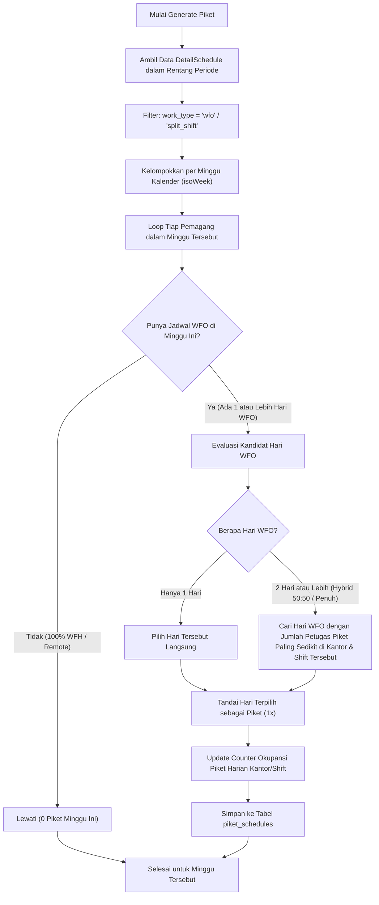

# Blueprint & Rencana Teknis Otomatisasi Jadwal Piket Kantor (Piket Automation Engine)

**Dokumen Rencana Teknis, Algoritma Pembagian, dan Arsitektur UI/Database**  
_Tanggal Rilis: 6 Oktober 2026_  
_Aplikasi: Sistem Absensi & Penjadwalan Pemagang (Absen Djuragan)_  
_Penempatan Modul: Menu Pengaturan Hari Libur & Info Kantor → Tab 4 (Jadwal Piket)_

---

## 1. Latar Belakang & Tujuan Fitur

Setelah mesin penjadwalan cerdas (_Auto Scheduling Engine 2.0_) berhasil menata alokasi kerja WFO, WFH, dan Hybrid secara akurat, muncul kebutuhan operasional penting berikutnya: **Otomatisasi Pembagian Jadwal Piket Kebersihan & Ketertiban Kantor**.

### 1.1. Masalah Saat Ini

- Jadwal piket saat ini masih dikelola manual menggunakan Google Spreadsheet luar (`piket_url`).
- Admin harus mencocokkan secara manual siapa yang masuk WFO dan siapa yang WFH agar tidak menunjuk pemagang yang sedang WFH untuk piket di kantor.
- Sering terjadi ketimpangan: satu hari piket terlalu banyak orang, hari lain kekurangan petugas.

### 1.2. Tujuan Pembaruan

- Mengambil data jadwal kerja yang **sudah dibuat dan diterapkan** (`detail_schedules`) sebagai dasar penugasan piket.
- Menjadwalkan piket secara otomatis dalam 1 klik dengan kepatuhan penuh terhadap aturan shift dan kehadiran fisik (WFO).
- Fitur ditempatkan **terpisah di menu Kelola Info & Hari Libur (Tab 4: Jadwal Piket)** agar terisolasi rapi dan tidak membebani menu _Simulator Jadwal Utama_.

---

## 2. Aturan Bisnis & Logika Penjadwalan Piket

Berdasarkan instruksi dan kebijakan operasional, berikut aturan mutlak yang wajib dipenuhi oleh algoritma piket:

```
┌─────────────────────────────────────────────────────────────────────────────┐
│                       ATURAN EMAS PENJADWALAN PIKET                         │
├─────────────────────────────────────────────────────────────────────────────┤
│ 1. Frekuensi         : 1 Pemagang mendapatkan jadwal piket TEPAT 1x per    │
│                        minggu kalender (Senin - Minggu).                    │
│ 2. Syarat Kehadiran  : Wajib memiliki jadwal WFO pada hari piket tersebut. │
│ 3. Penempatan Shift  : Piket dilakukan pada SHIFT PEMAGANG TERSEBUT         │
│                        (contoh: pemagang Shift Pagi piket di Shift Pagi).   │
│ 4. Pemagang Hybrid   : Jika bekerja skema Hybrid (misal 50:50 dengan        │
│                        3 hari WFO dan 3 hari WFH), sistem memilih 1 hari    │
│                        secara acak seimbang dari HARI-HARI WFO-NYA.         │
│ 5. Full WFH / Remote : Pemagang yang minggu tersebut 100% WFH / Remote      │
│                        OTOMATIS DILEWATI (tidak mendapatkan jadwal piket).  │
│ 6. Pemerataan Beban  : Jumlah petugas piket per hari per shift di setiap   │
│                        kantor DIBAGI SEIMBANG dari Senin sampai Sabtu.      │
└─────────────────────────────────────────────────────────────────────────────┘
```

---

## 3. Desain Arsitektur Data & Skema Database

Data piket disimpan dalam **tabel mandiri (`piket_schedules`)** agar tidak merusak integritas tabel absensi pokok (`detail_schedules`), namun tetap terhubung secara relasional.

### 3.1. Tabel Baru: `piket_schedules`

| Kolom                | Tipe Data                        | Keterangan                                     |
| :------------------- | :------------------------------- | :--------------------------------------------- |
| `id`                 | `BIGINT UNSIGNED (PK, Auto Inc)` | Primary key                                    |
| `intern_id`          | `BIGINT UNSIGNED (FK)`           | Relasi ke tabel `interns` (Cascade Delete)     |
| `office_id`          | `BIGINT UNSIGNED (FK)`           | Kantor lokasi piket (Cascade Delete)           |
| `shift_id`           | `BIGINT UNSIGNED (FK)`           | Shift saat piket bertugas (Cascade Delete)     |
| `detail_schedule_id` | `BIGINT UNSIGNED (FK, Nullable)` | Relasi ke jadwal kehadiran spesifik (Set Null) |
| `date`               | `DATE`                           | Tanggal penugasan piket                        |
| `notes`              | `VARCHAR(255), Nullable`         | Catatan opsional tugas piket                   |
| `created_at`         | `TIMESTAMP`                      | Waktu dibuat                                   |
| `updated_at`         | `TIMESTAMP`                      | Waktu diperbarui                               |

- **Unique Key:** `['intern_id', 'date']` — Mencegah pemagang mendapat 2x piket di hari yang sama.
- **Index:** `['date', 'office_id', 'shift_id']` — Mengoptimalkan query cepat roster piket harian.

### 3.2. Relasi Model Eloquent

- `PiketSchedule` belongsTo `Intern`, `Office`, `Shift`, `DetailSchedule`.
- `Intern` hasMany `PiketSchedule`.
- `DetailSchedule` hasOne `PiketSchedule`.

---

## 4. Algoritma Mesin Pembagian Piket (`PiketSchedulingService`)

Algoritma pembagian piket dirancang dengan pendekatan **Constraint Satisfaction & Least-Loaded Balancing**:



### Detail Langkah Penyeimbangan Kuota Harian (_Balancing Heuristic_):

1. **Inisialisasi Counter:** Buat matriks penghitung piket harian `dailyPiketCounts[office_id][shift_id][date] = 0`.
2. **Prioritas Pemagang Sedikit Opsi (MRV - Minimum Remaining Values):**
    - Pemagang yang hanya punya 1 hari WFO dialokasikan pertama kali.
    - Pemagang dengan 2 hari WFO diproses berikutnya.
    - Pemagang dengan banyak hari WFO (misal 5-6 hari WFO penuh) diproses terakhir untuk mengisi celah hari yang masih sepi.
3. **Pemilihan Hari:** Dari daftar hari WFO milik pemagang, pilih tanggal yang nilai `dailyPiketCounts` nya **paling kecil**.
4. **Hasil Akhir:** Roster piket dari Senin s/d Sabtu memiliki jumlah personil yang rata dan tidak jomplang.

---

## 5. Rencana Antarmuka Pengguna (UI/UX)

Fitur piket akan dipasang pada dua sisi antarmuka:

### 5.1. Sisi Admin: Tab 4 Menu Kelola Info & Hari Libur (`admin/pengaturan-holiday.blade.php`)

Di dalam `#content-tab-piket`, tampilan dibagi menjadi dua bagian terintegrasi:

1. **Bagian Atas: Panel Kontrol & Generator Otomatis:**
    - **Pilihan Periode:**
        - Tombol cepat: `Minggu Berjalan` | `Minggu Depan` | `Rentang Tanggal Kustom`
    - **Pilihan Kantor:** Dropdown filter kantor (Semua Kantor / Kantor Tertentu).
    - **Tombol Eksekusi:**
        - Tombol Hijau: `⚡ Generate Otomatis Jadwal Piket` (dengan modal konfirmasi SweetAlert & indikator loading).
        - Tombol Merah Outline: `Hapus / Reset Piket Periode Ini`.
    - **Ringkasan KPI Singkat:**
        - Total Petugas Piket Minggu Ini.
        - Rata-rata Petugas per Hari.
        - Pemagang WFH (Bebas Piket).

2. **Bagian Tengah: Kalender / Tabel Roster Piket Harian:**
    - Tampilan kartu hari (Senin, Selasa, Rabu, Kamis, Jumat, Sabtu).
    - Pada tiap hari, dikelompokkan berdasarkan **Kantor** dan **Shift**.
    - Menampilkan daftar nama pemagang piket, foto profil, divisi, dan jam shiftnya.
    - Dilengkapi fitur pencarian nama pemagang untuk memudahkan pengecekan.

3. **Bagian Bawah: Form Ketentuan & Link Spreadsheet (Fitur Eksisting):**
    - Tetap dipertahankan untuk menyimpan link backup Google Spreadsheet (`piket_url`) dan poin SOP piket kebersihan (`piket_description`).

---

### 5.2. Sisi Pemagang: Dashboard Pengguna (`users/index.blade.php`)

1. **Tab "Jadwal Piket" (Modal Info Kantor):**
    - **Kartu Status Pribadi:**
        > _"Jadwal Piket Anda Minggu Ini: **Rabu, 07 Oktober 2026** di **Kantor Utama** (Shift Pagi)"_  
        > _(Jika minggu tersebut 100% WFH: "Anda tidak bertugas piket minggu ini karena jadwal Anda WFH penuh.")_
    - **Daftar Rekan Sepiket Hari Ini:**
        - Menampilkan siapa saja teman piket di kantor dan shift yang sama hari ini.
    - **Poin Tugas Kebersihan:** Tetap menampilkan panduan SOP piket yang diset admin.

2. **Tabel "Jadwal Minggu Ini" (Halaman Utama Dashboard):**
    - Pada baris hari di mana pemagang mendapat giliran piket, ditambahkan lencana khusus:
      `🧹 Petugas Piket` berdampingan dengan badge `WFO`.

---

## 6. Tahapan Eksekusi Pembangunan (Action Plan) - Status: SELESAI

| Tahap | Aktivitas | File Terkait | Status |
| :---: | :--- | :--- | :---: |
| **1** | Membuat migrasi tabel `piket_schedules` dan menjalankan `php artisan migrate`. | `database/migrations/xxxx_create_piket_schedules_table.php` | ✅ Selesai |
| **2** | Membuat Model `PiketSchedule` dan relasi ke `Intern`, `Office`, `Shift`, `DetailSchedule`. | `app/Models/PiketSchedule.php` | ✅ Selesai |
| **3** | Membuat Service Engine `PiketSchedulingService` yang memuat logika 1x piket/minggu di hari WFO dan balancing harian (Senin - Sabtu). | `app/Services/PiketSchedulingService.php` | ✅ Selesai |
| **4** | Menambahkan route dan controller handler di `SettingHolidayController` (`generatePiket`, `getPiketRoster`, `resetPiket`). | `app/Http/Controllers/SettingHolidayController.php`, `routes/web.php` | ✅ Selesai |
| **5** | Merombak Tab 4 `admin/pengaturan-holiday.blade.php`: Menambahkan panel generator piket, ringkasan distribusi Senin-Sabtu, dan tabel roster interaktif. | `resources/views/admin/pengaturan-holiday.blade.php` | ✅ Selesai |
| **6** | Mengintegrasikan tampilan personal piket di dashboard pemagang (tabel jadwal, pengingat hari ini, dan Tab 4 modal). | `resources/views/users/index.blade.php`, `app/Http/Controllers/UserController.php` | ✅ Selesai |
| **7** | Pengujian menyeluruh (skema hybrid 50:50, pemagang remote dilewati, dan verifikasi distribusi merata). | Terminal, PHPUnit / Tinker, Web UI | ✅ Selesai |

---

_Dokumen ini menjadi acuan resmi implementasi otomatisasi jadwal piket di aplikasi Absen Djuragan._
