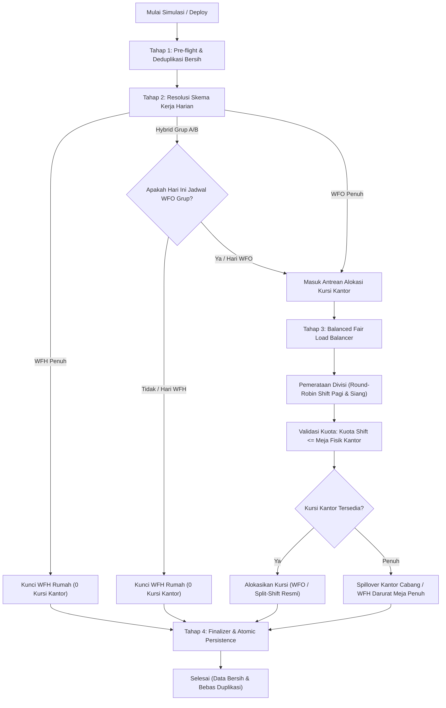
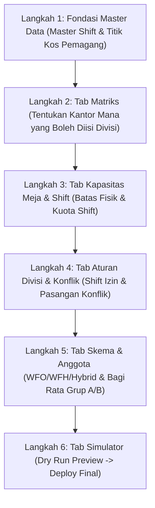

# Blueprint Rombak Otomatisasi Jadwal & Pembenahan Pengaturan (Total Overhaul)

**Dokumen Rencana Teknis, Standarisasi Data, dan Arsitektur Baru**  
*Tanggal Pembaruan: 6 Oktober 2026*  
*Aplikasi: Sistem Absensi & Penjadwalan Pemagang (Absen Djuragan)*

---

## 1. Analisis Akar Masalah (Mengapa Terjadi Duplikasi & Hasil Tidak Maksimal)

Berdasarkan audit komprehensif pada antarmuka admin (`admin/automation-rules`), controller (`AutomationRuleController`), dan mesin penjadwalan (`AutoSchedulingEngine`), ditemukan dua kategori masalah besar: **kerusakan logika alokasi kursi** dan **duplikasi pengaturan (*settings overlap*)**.

### 1.1. Masalah Mesin Penjadwalan (Backend Logic)
1. **Logika Kohort Hybrid Terbalik (Grup A & B Masih Bercampur):**
   * Di sistem lama, rotasi grup hanya dipicu di *Tier 4* saat kursi kantor sudah terisi penuh. Selama meja kantor masih ada yang kosong, baik anggota Grup A maupun Grup B sama-sama dimasukkan WFO Pagi.
   * **Dampak:** Grup A dan B duduk bercampur di satu kantor/shift yang sama. Pembagian grup menjadi tidak efektif.
2. **Alokasi "First-Fit Greedy" (Menumpuk di Satu Shift):**
   * Pemagang diproses secara sekuensial; pemagang pertama langsung menghabiskan kuota Shift Pagi sampai habis, baru pemagang berikutnya dibuang ke Shift Siang atau WFH.
   * **Dampak:** Shift Pagi sesak 100%, Shift Siang sepi, dan divisi tertentu menumpuk di satu shift tanpa pemerataan.
3. **Duplikasi Data Riil saat Deploy:**
   * Query deploy menggunakan `firstOrCreate` tanpa membersihkan riwayat tanggal yang dijadwalkan ulang. Jika seorang pemagang memiliki record jadwal masa lalu, detail schedule baru menumpuk di atas data lama, memicu pembacaan kuota ganda pada simulasi berikutnya.

### 1.2. Masalah Duplikasi Pengaturan di Antarmuka Admin (Settings Conflict)
1. **Duplikasi Pengaturan Shift (Tab 4 vs Halaman Manage Shift):**
   * Halaman **Manage Shift** (`/admin/pengaturan/shift`) sudah mengatur jam kerja, jam split-shift (WFH/WFO), dan deskripsi.
   * Namun di **Tab 4 Halaman Otomatisasi**, form pengaturan split-shift tersebut diduplikasi ulang. Bahkan terdapat kode yang memaksa Shift Pagi menjadi *non-split*:
     ```blade
     <input type="hidden" name="shifts[{{ $shift->id }}][is_split_shift]" value="0">
     ```
   * **Dampak:** Perubahan admin di Manage Shift sering tertimpa atau hilang saat menyimpan aturan di Tab 4.
2. **Tumpang Tindih Parameter Global (Tab 6 vs Tab 3 & Tab 5):**
   * Toggle global seperti *“Gunakan Split Shift (Tier 2)”* dan *“Gunakan Sistem Bergilir Hybrid (Tier 3)”* bertentangan dengan kebijakan divisi di Tab 3 dan kebijakan perorangan di Tab 5.
   * Ambang batas persentase okupansi di Tab 6 tidak riil digunakan karena batas kuota meja sudah diatur di Tab 2.
3. **Pembagian Grup "Auto" Sangat Primitif di Tab 5:**
   * Rumus bawaan Auto Grup hanya mengecek ganjil/genap ID database (`$id % 2`). Jika sebuah divisi beranggotakan pemagang dengan ID genap semua, seluruh divisi masuk Grup A! Divisi tersebut menjadi kosong total saat hari Grup B.

---

## 2. Prinsip "Single Source of Truth" (Jaminan Anti-Duplikasi Riil)

Agar tidak ada lagi pengaturan yang tumpang tindih (*zero settings conflict*), setiap domain data memiliki **SATU tempat resmi**:

```
┌────────────────────────────────────────────────────────────────────────┐
│                      PEMBAGIAN OTORITAS PENGATURAN                     │
├──────────────────────────────┬─────────────────────────────────────────┤
│ Domain Data                  │ Lokasi Pengaturan Tunggal (Resmi)       │
├──────────────────────────────┼─────────────────────────────────────────┤
│ 1. Master Shift & Jam Split  │ MENU MANAGE SHIFT (/admin/pengaturan/shift│
│    (Jam mulai, selesai, split│ -> Tidak boleh disentuh di Otomatisasi! │
│ 2. Meja Fisik & Kuota Shift  │ TAB 2 OTOMATISASI (Kapasitas Meja)      │
│    (Batas fisik kantor &     │ -> Kuota shift di-clamp <= meja fisik   │
│ 3. Akses Kantor & Divisi     │ TAB 1 & 3 OTOMATISASI                   │
│    (Matriks relasi, shift    │ -> Menentukan izin penempatan           │
│ 4. Skema Kerja & Grup Anggota│ TAB 4 OTOMATISASI (Kebijakan Pemagang)  │
│    (WFO / WFH / Hybrid A & B)│ -> Menentukan status harian pemagang    │
│ 5. Parameter Kalender Global │ TAB 5 OTOMATISASI (Simulator & Setting) │
│    (Skip holiday, Sundays)   │ -> Mengatur kalender hari kerja         │
└──────────────────────────────┴─────────────────────────────────────────┘
```

---

## 3. Restrukturisasi Halaman Otomatisasi (Dari 7 Tab Menjadi 5 Tab Bersih)

Halaman `admin/automation-rules` disederhanakan secara terpadu tanpa menghilangkan fitur fungsional apa pun:

```
[Tab 1: Matriks Kantor]  ──► Relasi kantor cabang mana saja yang boleh dimasuki divisi
[Tab 2: Kapasitas Kursi] ──► Meja fisik kantor & kuota per shift (Lapis 1 & Lapis 2)
[Tab 3: Aturan & Konflik]──► Izin shift per divisi + Aturan konflik pasangan (tidak boleh 1 shift)
[Tab 4: Skema & Anggota] ──► WFO Penuh / WFH Penuh / Hybrid 50% + Tombol Cerdas Bagi Rata Grup A/B
[Tab 5: Simulator & Run] ──► Kalender (libur/Minggu), Dry Run Preview, dan Deploy Final Bebas Dobel
```

### Rincian Perubahan Tiap Tab:
* **Tab 1 (Matriks):** Tetap dipertahankan (karena sudah tepat dan bersih).
* **Tab 2 (Kapasitas Meja & Shift):** Menggunakan sistem 2 lapis yang baru saja diperbaiki:
  $$\text{Kuota Kursi Shift} \le \text{Kapasitas Meja Fisik Kantor}$$
* **Tab 3 (Pola & Konflik):** 
  * Menghapus strategi distribusi yang membingungkan (`weekly_rotation`, `distance_optimized`).
  * Fokus murni pada: **Checklist Shift yang Diizinkan per Divisi** dan **Aturan Pasangan Konflik**.
* **Tab 4 (Skema & Anggota - Gabungan Eks Tab 5):**
  * Pengaturan massal: Tipe Penempatan (`wfo_only`, `wfh_only`, `hybrid`), Grup (`A` atau `B`), Kunci Kantor, dan Periode Magang.
  * **Aturan Kunci Sekolah Remote (Mutlak):** Jika sekolah pemagang diset sebagai *Sekolah Remote / Luar Kota* (`is_remote_school = 1`), maka tipe penempatan **terkunci otomatis (disabled / badge gembok: 🔒 WFH Penuh Sekolah)** dan tidak bisa diubah menjadi WFO. Shift-nya otomatis terkunci ke WFH Full.
  * **Fitur Baru Cerdas:** Tombol **"Bagi Rata Grup A & B per Divisi"** (membagi 50% A dan 50% B secara proporsional per divisi, bukan ID genap/ganjil).
* **Tab 5 (Simulator & Deploy - Integrasi Eks Tab 6 & 7):**
  * Pengaturan parameter kalender operasional (*Skip Holidays*, *Include Sundays*) diletakkan langsung di panel Simulator.
  * Hapus seluruh konsep toggle tier palsu (*Tier 2/Tier 3 toggles*) yang membuat logic menabrak skema kerja.

---

## 4. Arsitektur Mesin Baru: "Multi-Stage Constrained Pipeline"

Mesin `AutoSchedulingEngine` dirombak total menggunakan 4 tahap eksekusi linier yang tegas:



### Logika Kunci WFH Sekolah Remote (Lock Otomatis Hanya untuk Full WFH):
* **Hanya untuk Pemagang WFH Penuh (Sekolah Remote / Luar Kota):**
  * Jika sekolah pemagang diset `is_remote_school = true`, sistem menguncinya secara mutlak ke **WFH Penuh**.
  * Diabaikan dari antrean pencarian meja kantor (0 meja kantor).
  * Shift otomatis terkunci ke **Shift Default WFH** (tidak bisa di-assign ke Shift Pagi/Siang kantor).
  * Status catatan: `"WFH Penuh (Sekolah Remote: [Nama Sekolah])"`.
  * Tidak dapat dialihkan ke kantor cabang mana pun (*No Spillover*).
* **Untuk WFH Biasa / Hybrid (Selang-Seling WFO-WFH):**
  * **Tetap aman, fleksibel, dan 100% bisa disetting oleh admin!** Admin tetap bebas mengatur grup (Grup A atau B), shift saat hari WFO, kunci kantor, maupun preferensi divisi. Penguncian hanya berlaku eksklusif untuk yang Full WFH dari kampus luar kota.

### Logika Kunci Pemisahan Grup (Grup A & B Anti-Bercampur):
Penentuan WFO/WFH untuk anggota hybrid dilakukan **sebelum** perebutan kursi kantor dimulai:
* **Senin, Rabu, Jumat:** Grup A = **WFO**, Grup B = **WFH** (Mutlak di rumah, nol meja kantor).
* **Selasa, Kamis, Sabtu:** Grup A = **WFH**, Grup B = **WFO** (Mutlak di rumah, nol meja kantor).
* Minggu berikutnya dirotasi terbalik secara otomatis agar akumulasi jam kerja setara.
* **Hasil:** Anggota Grup B tidak akan pernah mengambil kursi saat jadwal Grup A berjalan. **100% bebas dari bercampurnya grup di satu shift.**

### Logika Kunci Pembagian Shift Merata (Anti-Menumpuk):
* Menggunakan algoritma **Round-Robin Berbobot per Divisi**:
  * Divisi X memiliki 10 orang yang hadir WFO hari ini.
  * Alih-alih memasukkan ke-10 orang ke Shift Pagi, sistem membagi: Orang 1 $\rightarrow$ Pagi, Orang 2 $\rightarrow$ Siang, Orang 3 $\rightarrow$ Pagi, Orang 4 $\rightarrow$ Siang, dst.
  * Hasil: Kedua shift terisi seimbang dan proporsional.

---

## 5. Rencana Aksi Eksekusi (Implementation Steps)

| Langkah | Komponen | Tindakan Nyata | File Sasaran |
| :---: | :--- | :--- | :--- |
| **1** | **Database & Model** | Pastikan relasi clean, validasi kunci unik `(schedule_id, date)`. | `app/Models/DetailSchedule.php` |
| **2** | **Engine Rewrite** | Tulis ulang `AutoSchedulingEngine.php` dengan pola Pipeline 4 Tahap, implementasi Cohort Resolver & Round-Robin Load Balancer. | `app/Services/AutoSchedulingEngine.php` |
| **3** | **Anti-Duplication Deploy** | Buat pembersihan atomik rentang tanggal jadwal lama sebelum eksekusi insert jadwal baru pada proses deploy. | `app/Services/AutoSchedulingEngine.php` |
| **4** | **Controller Refactor** | Sederhanakan method simpan di `AutomationRuleController.php` sesuai 5 tab baru, hapus method simpan shift yang bertabrakan. | `app/Http/Controllers/AutomationRuleController.php` |
| **5** | **UI Restructuring** | Rombak `automation-rules.blade.php` menjadi 5 Tab Bersih, hapus form duplikat shift, tambahkan tombol bagi rata Grup A/B. | `resources/views/admin/automation-rules.blade.php` |
| **6** | **Testing & Verifikasi** | Jalankan simulasi uji coba untuk memastikan: tidak ada duplikasi data, Grup A & B terpisah sempurna, dan kursi terbagi rata. | Terminal / Artisan / Web Simulator |

---

## 6. Panduan SOP: Urutan Pengaturan yang Benar (Agar Hasil Maksimal)

Agar mesin otomatisasi bekerja optimal, bebas konflik, dan menghasilkan jadwal yang seimbang, admin harus mengikuti urutan konfigurasi berjenjang (*Bottom-Up Hierarchy*) berikut:



### Tahap 1: Fondasi Master Data (Sebelum Masuk Menu Otomatisasi)
1. **Master Shift ([Manage Shift](file:///d:/laragon/www/absen-djuragan/resources/views/admin/pengaturan-shift.blade.php)):**
   * Pastikan nama shift, jam operasional, dan skema split-shift (jika ada) sudah valid.
2. **Kelengkapan Profil Pemagang ([Data Pemagang](file:///d:/laragon/www/absen-djuragan/resources/views/admin/intern.blade.php)):**
   * Pastikan **Masa Magang** (`start_date` & `end_date`) sudah terisi (pemagang tanpa masa magang otomatis dilewati engine).
   * Pastikan **Titik Koordinat Kos/Rumah** sudah ditandai di peta agar perhitungan jarak ke kantor akurat.

---

### Tahap 2: Pengaturan Aturan di Menu Otomatisasi (Urutan 1 s/d 4)
* **Langkah 1 (Tab 1: Matriks Divisi & Kantor):**
  * Tentukan kantor mana saja yang boleh ditempati tiap divisi. Centang kantor yang relevan.
* **Langkah 2 (Tab 2: Kapasitas Meja & Shift):**
  * Isi **Kapasitas Meja Fisik Kantor** (jumlah kursi asli di ruangan, misal: 15 meja).
  * Aktifkan shift yang beroperasi di kantor tersebut.
  * Tentukan **Kuota Kursi per Shift** (misal: Pagi 10 kursi, Siang 8 kursi). *Sistem otomatis mengunci agar kuota tidak melebihi kapasitas fisik*.
* **Langkah 3 (Tab 3: Aturan Divisi & Pasangan Konflik):**
  * Pilih shift mana saja yang diizinkan untuk tiap divisi (misal Divisi IT = Pagi & Siang; Divisi Konten = Hanya Pagi).
  * Masukkan aturan **Pasangan Konflik** jika ada 2 pemagang yang bermusuhan dan tidak boleh dijadwalkan bersamaan.
* **Langkah 4 (Tab 4: Skema & Anggota):**
  * Tentukan **Tipe Penempatan** per orang:
    * `WFH Penuh`: Untuk pemagang luar kota / remote (tidak memakan kursi kantor).
    * `WFO Penuh`: Untuk pemagang yang wajib selalu hadir fisik.
    * `Hybrid 50%`: Untuk pemagang yang berotasi selang-seling.
  * Klik tombol **"Bagi Rata Grup A & B per Divisi"** agar kekuatan tim terbagi 50:50 yang seimbang.
  * Atur **Kunci Kantor** hanya untuk pemagang khusus yang mutlak harus di cabang tertentu.

---

### Tahap 3: Eksekusi di Simulator (Tab 5)
1. Pilih rentang tanggal penjadwalan (misal: 1 minggu atau 1 bulan ke depan).
2. Pastikan opsi **Lewati Hari Libur Nasional** aktif.
3. Klik tombol **"Simulasikan Jadwal (Dry Run)"**:
   * Periksa kartu okupansi: pastikan tidak ada hari yang *overcapacity*.
   * Periksa pembagian shift: pastikan Pagi dan Siang terisi merata.
   * Periksa pemisahan grup: pastikan Grup A dan B tidak hadir di kantor pada hari yang sama.
4. Jika hasil simulasi sudah sempurna, klik tombol **"Terapkan Jadwal ke Database (Deploy)"**.

---

## 7. Jaminan Hasil Setelah Implementasi
1. **Tidak Ada Duplikasi Pengaturan:** Pengaturan jam kerja hanya ada di Manage Shift, kapasitas hanya ada di Tab Kuota Meja, skema hanya ada di Tab Kebijakan.
2. **Tidak Ada Duplikasi Data Jadwal:** Data jadwal lama rentang tanggal terkait di-purge sebelum insert baru, mencegah bug dobel entri dan kuota error.
3. **Pemisahan Grup Nyata:** Grup A dan Grup B terisolasi sesuai jadwal masing-masing.
4. **Pemerataan Beban:** Tidak ada lagi satu shift yang sesak 100% sementara shift lain kosong.
